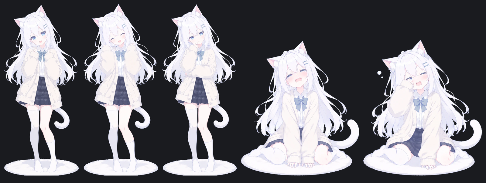

# 对话立绘 · Chat portrait

> 一个 DSH（DeepSeek Harness）插件：在对话界面右侧挂一位角色，随对话内容换表情、换姿势。



## 它做什么

- **位置**：挂靠窗口右侧，底部停在输入框上方；对话流右侧自动留出同样的宽度（`[data-chat-flow]` 的 `padding-right`），文字不会被立绘压住
- **情绪**：读最后一条 assistant 回复的结尾文本，按关键词打分选情绪；有对应差分就换脸，没有就换姿势
- **工作中**：运行期间跟着干活状态走——工具失败 → 沮丧，有新文字流出 → 开心，其余 → 思考
- **点一下**：害羞 + 抖一下，1.1 秒后自己切回来
- **收起**：鼠标移上去浮出小控制条，点 `×` 收起；右下角猫耳按钮叫回来

## 安装

```bash
git clone https://github.com/<you>/dsh-chat-portrait.git ~/dsh-chat-portrait
```

然后在 DSH 里用绝对路径安装这个 bundle：

```js
plugin_manager({ action: 'install_bundle', target: '/absolute/path/to/dsh-chat-portrait' })
```

或者手动：把目录加进 profile 的 `package.json` 依赖，再 `install_bundle`。

## 加表情差分

1. 把差分图丢进 `assets/source/`，**文件名就是情绪 id**：

   ```
   assets/source/neutral.png
   assets/source/happy.png
   assets/source/sad.png
   ```

   透明底，画布尺寸和现有图一致（1024×1536 最省事）。

2. 跑两步：

   ```bash
   python tools/normalize-portraits.py   # 统一缩放 → assets/<id>.webp
   node tools/pack-portraits.mjs         # 把 webp 内联进 assets/portrait.json
   ```

   `normalize` 对每张图按自己的内容框裁剪、套用**同一个缩放系数**，所以站姿之间像素级对齐；
   跪坐这类换姿势的图会自然矮下去，而不是被强行拉成一样高。

3. 刷新 Harness 页面。

没图也不会坏：清单里列了 9 种情绪，磁盘上没有的会在运行时被探测出来并回退到 `neutral`。

## 单张微调（大小 / 位置补偿）

AI 生成差分时偶尔不会沿用同一机位。改 `assets/portrait.json` 里对应那一行的三个数即可：

```json
"sad": { "file": "sad.webp", "label": "低落", "scale": 1.05, "offsetX": 0, "offsetY": 0 }
```

| 字段 | 作用 |
| --- | --- |
| `scale` | 以底边中点为原点缩放，`1` = 原始 |
| `offsetX` | 水平位移（px，正数向右） |
| `offsetY` | 垂直位移（px，正数向下） |

改完刷新页面就生效，不用重跑打包脚本。

想先看所有差分摆在一起：

```bash
python tools/alignment-sheet.py     # docs/alignment-check.png
python tools/ground-check.py        # 按运行时几何布局
python tools/scale-compare-small.py # 几个 scale 档位对比
```

## 九种情绪

| id | 触发例 |
| --- | --- |
| `neutral` | 默认 |
| `happy` | 开心、太好了、成功、搞定、谢谢 |
| `excited` | 好耶、太棒、冲呀、终于 |
| `sad` | 难过、抱歉、对不起、遗憾、唉 |
| `angry` | 生气、可恶、讨厌、烦死、炸毛 |
| `surprised` | 诶、咦、哇、居然、竟然、没想到 |
| `shy` | 害羞、脸红、嘿嘿、贴贴、喜欢你 |
| `thinking` | 让我想想、先想想、分析一下、思考 |
| `sleepy` | 困了、晚安、哈欠、熬夜 |

规则在 `client.js` 的 `SIGNALS` 里，越靠前的规则在打平时越占优势。改完跑一次校验：

```bash
node tools/emotion-test.mjs
```

## 实现方式

- **Host 半** `index.js`：把包内 `assets/` 挂在 `/chat-portrait/` 前缀路由上，访问空前缀即返回清单
- **Client 半** `client.js`：注册进 `conversation.composer.dock` 槽位（拿 Session 的 `useChat` 投影），
  `createPortal` 到 `document.body` 渲染固定定位的立绘
- 让位是一条纯 CSS 规则：`body:has(> .cp-root[data-hidden="false"]) [data-chat-flow] { padding-right: … }`
- 图片以 data URL 内联在清单里，切表情不产生额外请求
- 高度比在预加载阶段就记进 manifest，切图第一帧就是正确尺寸，不会闪一帧放大版

## 素材说明

`assets/source/` 里是原始差分图，`assets/*.webp` 是脚本生成的运行时素材。
角色立绘版权归作者所有，本项目只作为个人使用示例；换成你自己的角色时替换 `assets/source/` 即可。
